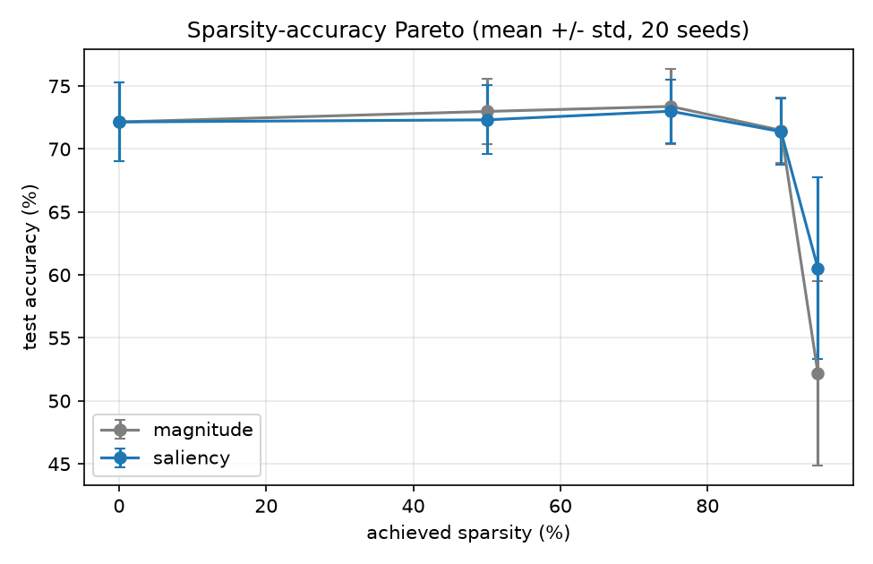

# Self-Pruning Network

A reverse-mode autodiff engine written from scratch in NumPy, and an MLP that prunes its own
connections while it trains: it decides which weights matter, removes the rest to a hard sparsity
budget, and reports what that cost and saved.

- No PyTorch, TensorFlow, JAX, Keras or any autodiff/NN/pruning library is used.
- **scikit-learn is used only to load MNIST** (`train/data.py: load_mnist`). It is never used for
  models, training or gradients.
- The four required design answers are in [`DESIGN.md`](DESIGN.md); this README covers the
  approach, how to run it, and the results.

## TL;DR

| Area | Summary |
|---|---|
| **Engine** | Tensor graph + topological `backward()`, 18 finite-difference gradient checks |
| **The trap** | A masked weight's gradient is 0, but Adam's moments are not. The optimizer clears state on every mask change, so pruned weights stay exactly 0 and revived weights restart cleanly. Tests fail if this is broken. |
| **Criterion** | Saliency `\|w·g\|` (first-order Taylor estimate of the loss change from removing a weight), EMA-smoothed |
| **Schedule** | Cubic ramp to the target sparsity over 60% of training, then fine-tune at fixed sparsity |
| **Claim** | At 90% sparsity on noisy spirals, saliency beats magnitude by **+1.5 pts** (paired 95% CI [+0.5, +2.4], 20 seeds, pre-specified) |
| **Replication** | Pre-specified 95% test on MNIST: saliency **+0.6 pts** (CI [+0.3, +0.9]). Not uniformly better: magnitude wins at 75-90% on MNIST. |
| **Cost** | 0.10x multiply-adds at 90% via a real sparse path. **No wall-clock speedup** in NumPy, reported as such. |

## Approach

### How the pieces fit

```
   data ──► MLP (Linear + ReLU) ──► softmax-cross-entropy ──► loss
              │  forward uses w_eff = w ⊙ mask                  │
              │                                                 ▼
              │                                          loss.backward()
              │                         ┌───────────────────────┴───────────────┐
              │                   w.grad = g ⊙ mask                    w.dense_grad = g
              │                   (what the optimizer uses)            (kept for regrowth)
              │                         │                                       │
              │                         ▼                                       ▼
              │                pruner.accumulate()  ── EMA of |w·g| per weight ─┘
              │                         │
              │                         ▼
              │                opt.step()          Adam, mask-aware: update ⊙ mask,
              │                         │          dead weights re-zeroed
              │                         ▼
              └──────────────  pruner.maybe_prune() every half epoch:
                               target s(t) from cubic schedule
                               keep top-k scores per layer, drop the rest
                               opt.set_mask() clears m, v, t where the mask changed
```

### Part 1: engine (`engine/tensor.py`)

- Each op records its parents and a closure that pushes the gradient back; `backward()` walks the
  graph in reverse topological order.
- Broadcasting is handled in one place (`_unbroadcast` sums gradients over broadcast axes).
- Softmax and cross-entropy are fused and computed with the log-sum-exp trick, so large logits do
  not overflow.
- Calling `backward()` twice accumulates only into leaves (like PyTorch), and constant branches
  that never receive a gradient are skipped. Both are tested.

### Part 1: the masked-weight trap (`train/optim.py`)

This is where a naive implementation silently breaks:

```
step 0: weight pruned, grad = 0          naive Adam: m, v still hold old values
step 1: update = lr · m / (√v + eps) ≠ 0  ──► "pruned" weight drifts away from 0
revive: stale m, v and step count t       ──► first update is the wrong size
```

The fix has three parts, each covered by a test in `tests/test_masked.py`:

1. Updates are multiplied by the mask and dead weights are re-zeroed after every step.
2. `set_mask()` clears `m`, `v` and `t` for every element whose mask changed, in both directions.
3. The step count `t` is per element, so a revived weight gets a fresh bias correction. The test
   checks its first step is exactly `lr` in size.

The tests check optimizer state directly. They were verified by breaking `set_mask` on purpose
and confirming the revive and SGD-momentum tests fail.

### Part 2: dense baseline (`train/train_dense.py`)

A 2-64-64-3 MLP trained with Adam on 3-arm spirals reaches 100% train and test accuracy, with a
learning curve in `results/dense_curve.png`.

He init (std = sqrt(2/fan_in)) is used because ReLU zeroes about half of each layer's inputs,
halving activation variance per layer. The factor of 2 compensates, so activations neither vanish
nor explode with depth.

### Part 3: self-pruning (`prune/`)

| Decision | Choice | Why |
|---|---|---|
| Importance | saliency `\|w·g\|` | Taylor: removing `w` changes the loss by about `-g·w`. A large weight on a dead path has `g = 0` and does not matter; magnitude `\|w\|` would keep it. Derivation and caveats: DESIGN.md §1. |
| Noise | EMA (0.9), bias-corrected | One mini-batch gradient is noisy. |
| Granularity | per layer | Score scales differ between layers, so a global threshold can wipe out a whole layer. |
| Schedule | cubic `s(t) = s_f·(1 − (1 − progress)³)` | Prunes fast while there is redundancy and slowly near the target. Runs from epoch 1 to 60% of training; the last 40% fine-tunes. |
| Honesty | stored weights are exactly 0 | `train_prune.run` asserts it at the end of every run. |
| Budget | hard | Achieved sparsity is 90.0% / 95.0%, not "about". |
| Regrowth (bonus) | grow the dead weights with the largest recent `\|dense_grad\|` | A revived weight starts at 0 and would be cut at once, so it gets a 1-event grace period and a reset score EMA. |

### Part 4: evidence (`train/sweep.py`, `train/sweep_mnist.py`)

- **Two criteria, same everything else.** Magnitude and saliency use identical hyperparameters,
  and nothing is tuned per criterion.
- **Paired seeds.** The same seed gives the same data, init and batch order for both criteria, so
  each seed yields one paired difference.
- **Statistics.** Each comparison reports the mean paired difference with a percentile bootstrap
  95% CI over 20 seeds.
- **Pre-specified tests.** The primary comparison (90%, spirals) was fixed before the sweep. The
  95% gap was noticed after the fact, so it was fixed in advance as the single confirmatory test
  on MNIST, with fresh seeds (100-119).
- **Harder dataset.** Default 3-arm spirals reach 100% at every sparsity and cannot show any cost.
  The sweep therefore uses 5 arms with noise 0.45, where the dense model reaches about 72%.
- **Real cost measurement.** `prune/sparse.py` stores only the non-zero weights (column-sorted COO)
  and computes with gather + `reduceat`, so FLOPs and parameter counts are measured on a path that
  never touches the zeros. Wall-clock is also timed and reported.

## Results

Mean test accuracy (%) over 20 seeds.

| Sparsity | Spirals magnitude | Spirals saliency | MNIST magnitude | MNIST saliency |
|---|---|---|---|---|
| 0% (dense) | 72.2 | 72.2 | 95.0 | 95.0 |
| 50% | 72.5 | 72.7 | 94.5 | 94.6 |
| 75% | 72.9 | 73.2 | 94.1 | 93.7 |
| 90% | 70.9 | **72.4** | **92.7** | 92.3 |
| 95% | 53.8 | **61.7** | 90.5 | **91.1** |



- **Claim** (`results/CLAIM.md`, pre-specified): at 90% sparsity on spirals, saliency beats
  magnitude by +1.5 pts (paired 95% CI [+0.5, +2.4], 16/20 seeds). This would be falsified if a
  re-run with new seeds gave a CI including 0 or below.
- **Replication** (`results/MNIST.md`, pre-specified): at 95% on MNIST, saliency is ahead by
  +0.6 pts (CI [+0.3, +0.9]).
- **Not uniformly better:** on MNIST at 75-90%, magnitude wins by about 0.4 pts.
- **Cost of pruning:** at 90% sparsity, about 0 pts on spirals (saliency) and about 2.7 pts on
  MNIST.
- **Compute** (`results/cost.json`): at 90%, active weights fall from 4,544 to 455 and multiply-adds
  to 0.10x. Wall-clock is **slower** than dense BLAS (about 1 ms vs 0.15 ms per batch of 256),
  because NumPy gather overhead outweighs the saved FLOPs. This is a real reduction in work and
  parameters, but not a latency speedup. DESIGN.md §3 explains why and what would fix it.
- **Regrowth** (`results/REGROW.md`): it works mechanically (revived weights train and some are
  kept), but it has no reliable accuracy effect. This is a null result.

Limitations (small datasets, one replication, how the spirals difficulty was chosen) are listed
at the end of DESIGN.md.

## Install

Python 3.10+.

    python -m venv .venv
    source .venv/bin/activate          # Windows: .venv\Scripts\activate
    pip install -r requirements.txt

The MNIST commands download MNIST from OpenML on first use (about 50 MB, cached by scikit-learn).

## Commands

| What | Command | Time | Writes |
|---|---|---|---|
| All tests (gradient checks, masked-weight tests, pruning, regrowth) | `pytest tests -q` | ~5 s | |
| Part 2: dense training + learning curve | `python -m train.train_dense` | ~5 s | `results/dense_curve.{json,png}` |
| Part 3: self-pruning run vs dense | `python -m train.train_prune --sparsity 0.9 --criterion saliency` | ~5 s | `results/prune_curve.{json,png}` |
| Part 4: Pareto sweep, baseline, cost, claim | `python -m train.sweep` | ~4 min | `results/pareto.png`, `sweep_raw.json`, `summary.json`, `cost.json`, `CLAIM.md` |
| Bonus: regrowth ablation | `python -m train.ablate_regrow` | ~2 min | `results/REGROW.md`, `regrow_ablation.json` |
| Bonus: MNIST replication | `python -m train.sweep_mnist` | ~18 min (7 processes) | `results/MNIST.md`, `mnist_*` |

All seeds are fixed. Re-running the commands from a clean clone reproduces the committed numbers
exactly (checked for sample spirals and MNIST runs on the same machine; other BLAS builds may
differ in the last digits).

## Where to look

| To check... | Read |
|---|---|
| Gradient correctness | `engine/tensor.py`, `tests/test_gradcheck.py` |
| The masked-weight / optimizer-state fix | `Tensor.masked`, `train/optim.py: set_mask`, `tests/test_masked.py` |
| Criterion derivation | `prune/criteria.py`, DESIGN.md §1 |
| Pruning loop and schedule | `prune/pruner.py`, `prune/schedule.py` |
| That the cost is measured, not dense × 0 | `prune/sparse.py`, `train/sweep.py: cost` |
| The statistics | `train/sweep.py: paired_bootstrap`, `results/CLAIM.md` |
| How the work evolved, including a bug found and fixed | `git log` (not squashed) |

## Layout

    engine/tensor.py     Tensor, ops, backward(), masked(), softmax_cross_entropy
    nn/layers.py         Parameter (with mask), Linear (He init), ReLU, Sequential
    train/optim.py       mask-aware SGD-momentum and Adam
    prune/criteria.py    magnitude and saliency |w*g| scores
    prune/schedule.py    cubic sparsity ramp
    prune/pruner.py      the self-pruning controller (+ optional regrowth)
    prune/sparse.py      sparse-aware inference path (stores only non-zero weights)
    train/               data, training loops, sweeps
    tests/               32 tests
    results/             every number and plot quoted above
